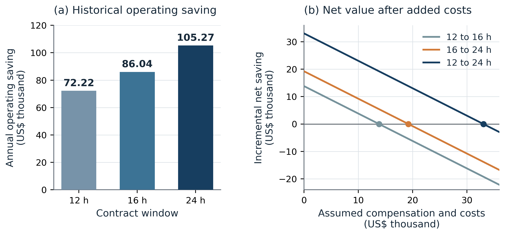

Contract rights and the economic value of data centre flexibility

Xiang Yi¹,*, Yuyang Chen²,†, Shengye Guan²,†

¹ Northwest Minzu University, Lanzhou, Gansu, China

² School of Management, Lanzhou University, 222 Tianshui South Road, Lanzhou 730000, Gansu, China

† Yuyang Chen and Shengye Guan contributed equally as joint second authors.

* Correspondence: Xiang Yi (mohamwdkali@gmail.com).

Author emails: Yuyang Chen (chenych2024@lzu.edu.cn); Shengye Guan (guanshy2024@lzu.edu.cn).

# Abstract

Contractual scheduling rights determine which electricity-saving schedules are available while completing the same admitted computing service. We identify a minimum value of broader rights by comparing an exactly feasible expanded-rights witness with a global narrower-rights ceiling. Two independently assembled formulations of the same relaxation, exact arithmetic and monetary repair allowances verify the comparison. In a four-site 2025 New York replay, the 24 h perfect-information opportunity lies between US\$130,931.31 and US\$134,437.85, with at least US\$30,305.84 unavailable under 12 h rights. The construction holds for every admission array compatible with the released reference ledger. Separately, independent re-settlement reproduces WorldMoE's US\$105,271.06 annual operating saving; same-checkpoint expansion from 12 to 24 h adds US\$33,050.09 before new contracting costs. An information-gap identity explains why these historical quantities do not identify ex-ante attainable value. Net-value intervals distinguish the operator's payment budget from tenant participation and joint surplus, making explicit what further evidence a prospective transaction requires.

**Keywords:** data centre flexibility; contractual scheduling rights; value bounds; nonanticipativity; tenant compensation; electricity settlement.

# 1 Introduction

The economic value of a longer computing deadline is the increase in electricity-cost saving attainable while completing the same admitted service. Its valuation starts with a contract: which task may run in which interval, under which capacity and completion obligations? Extending a deadline creates additional authorised schedules, but their value depends on electricity prices, physical import requirements and competition for future computing capacity. The procurement question is how much an operator can justify paying for that discretion. This complements research on remunerating workload shifts and tenant flexibility [1] [2], while requiring a comparison of entire contractual opportunity sets under one financial account.

We identify this value by combining a feasible schedule under expanded rights with a global saving ceiling under narrower rights. Let $A$ and $B$ denote contracts with nested feasible sets, $U_A$ a valid upper bound on A’s attainable saving, and $H_B$ a fully settled, feasible B schedule. If $H_B>U_A$, at least $H_B-U_A$ of B’s saving is unavailable under every A-feasible schedule. The result covers all narrower-rights controllers, including schedules chosen with hindsight on the recorded calendar. It attributes this minimum increase in attainable value to the change in contractual rights within the stated model. Admissions, equipment, exogenous prices, the reference schedule and the monetary treatment of closing obligations remain fixed.

The same construction supplies an upper endpoint for the rights premium and bounds the additional value available to improved control. The distance from an operating policy to a relaxed ceiling includes achievable improvement and relaxation slack; the entire distance cannot be assigned to the controller. We further relate prospective contract value to perfect-information opportunity through the change in the information gap between contracts. Longer deadlines can change both the schedules available and the information needed to exploit them. Finally, the value interval gives sufficient and exclusion conditions for profitable procurement. Tenant compensation affects the operator’s margin and tenant participation, while cancelling as an internal transfer when their joint surplus is evaluated.

These monetary comparisons require exact contractual feasibility. A small service residual is not itself a dollar-valued guarantee. We retain each cohort’s exclusive deadline, construct a capacity-compatible repair for homogeneous contracts, and deduct a price-weighted upper bound on its settlement effect. Finite-box dual evaluation accounts for multiplier signs, residuals and monetary rounding. Two formulations of a common convex relaxation provide a way to cross-check the cost lower bound and resulting saving ceiling. Complete constructions and verification records are organised by their evidential scope in the Supplementary Information.

WorldMoE supplies a concrete operating policy with which to measure captured value. Its market forecasts, physical import valuation and treatment of outstanding service connect the policy to the model’s cost and capacity terms. The rights bounds apply independently of this choice of controller. In the four-site 2025 New York replay, independent re-settlement reproduces US\$105,271.06 in annual operating savings. Historical matched-checkpoint comparisons give a mean increase of US\$33,050.09 from 12 h to 24 h rights before additional contracting costs. The independently verified 24 h opportunity is US\$130,931.31–134,437.85, with at least US\$30,305.84 unavailable under 12 h rights on that calendar. The fixed-policy comparison and the bound address different economic objects, and the net-value conditions establish what further information is needed to support a mutually acceptable contract.

# 2 Contract rights and value identification

## 2.1 Authorised service and a common financial account

Time is divided into 15 min slots. Let $a_t$, $x_t$ and $q_t$ denote admitted work, executed work and outstanding work immediately before admission in slot $t$. Conservation requires

$$
q_{t+1}=q_t+a_t-x_t,\qquad 0\le x_t\le q_t+a_t.
\qquad\text{(1a)}
$$

A cohort $j$ arrives at the start of slot $r_j$. Its deadline $d_j$ is the boundary by which execution must finish. For a contract of $W_j$ hours and $\Delta t=0.25$ h, the exact eligible interval is

$$
D_j=W_j/\Delta t=4W_j,\qquad
d_j=r_j+D_j,\qquad
I_j=\{r_j,\ldots,d_j-1\}.
\qquad\text{(1b)}
$$

Thus a 24 h cohort has 96 eligible slots including arrival; slot $r_j+96$ is excluded. Let $v_{jt}$ be cohort-to-slot execution and $\bar x_t$ the service-capacity limit. The contractual constraints are

$$
v_{jt}\ge0,\qquad
\sum_{t\in I_j}v_{jt}=a_j,\qquad
x_t=\sum_{j:t\in I_j}v_{jt}\le\bar x_t.
\qquad\text{(1c)}
$$

Execution outside $I_j$ is zero. Initial cohorts retain their original deadlines, and cohorts crossing the reporting boundary retain their remaining time. Shortening a deadline to year end changes the contract; choosing earlier service is merely one policy within it. Physical completion after year end and the monetary valuation of a closing liability are checked separately.

For homogeneous duration $D$ and an initially empty ledger, define $A_t=\sum_{s\le t}a_s$ and $X_t=\sum_{s\le t}x_s$, with admissions zero outside their source horizon. Earliest-deadline allocation makes cohort feasibility equivalent to

$$
A_{t-D+1}\le X_t\le A_t,\qquad 0\le x_t\le\bar x_t.
\qquad\text{(1d)}
$$

The checks include the full completion horizon. Heterogeneous deadlines retain Eq. (1c): aggregate release and due totals alone can conceal service allocated to the wrong cohort. Supplementary S19 gives the equivalence proof and a mixed-deadline counterexample. Electrical restrictions and nonpreemptive placement, where applicable, add their own constraints to the authorised set.

All contract comparisons use the same immediate-service reference and financial account. The stored reference remains the fixed expense and import-deviation anchor; its floating execution is not redefined as the unknown admissions. The reference and policy hold an identical day-ahead import position, with changes settled at real-time prices [3]. For site $z$ and policy $\pi$,

$$
S_\pi=C_0-C_\pi
=\sum_{z,t}\lambda^{RT}_{z,t}
\big(G_{0,z,t}-G_{\pi,z,t}\big)\Delta t
-\Delta K-\Delta\Psi.
\qquad\text{(2)}
$$

Here $G$ is grid import, $\Delta K$ contains the import-deviation and PV-curtailment charge differences, and $\Delta\Psi$ is the difference in terminal liabilities. The declared annual account prices closing work using frozen zonal median RT prices, maximum specified PUE and the work-to-energy conversion. Actual recovery cash flows and terminal valuation must be reconciled so the same obligation is not charged twice. Common fixed charges cancel in savings but remain in expenditure denominators.

## 2.2 Historical saving, perfect information and prospective value

Fix a probability law $\mathbb P$ at contract signing and a common information rule. Immutable numerical vintage $d_k^{(1)}$ becomes available after receipt $\rho_k$ and processing delay $\delta_k$. Preprocessing and selected checkpoints are frozen at $\theta_0$. A decision-time filtration may be written

$$
\mathcal F_t=\sigma\!\left(
\theta_0,\{d_k^{(1)}:\rho_k+\delta_k\le t\},
\{x_s:s<t\}\right),
\qquad x_t\ \text{is }\mathcal F_t\text{-measurable}.
\qquad\text{(3a)}
$$

The released-work state and other permitted observations enter this filtration through their recorded availability. Later archival revisions do not become historical decision inputs merely because they are available for settlement reconstruction.

Let $\mathcal X_W(\omega)$ contain all schedules satisfying contract $W$ on realised path $\omega$, and let $\Pi_W^{\mathcal F}$ contain policies adapted to the permitted information that satisfy those constraints almost surely. Define

$$
V_W^{PI}(\omega)
=\sup_{x\in\mathcal X_W(\omega)}
\big[C_0(\omega)-C(x,\omega)\big],
\qquad
V_W^{\mathcal F}
=\sup_{\pi\in\Pi_W^{\mathcal F}}\mathbb E[S_W^\pi].
\qquad\text{(3b)}
$$

The first value allows the optimiser to see the whole realised path. The second selects a policy before future observations are revealed. Assume finite, measurable and integrable values. Every adapted feasible policy generates a pathwise feasible schedule, so

$$
\mathbb E[S_W^\pi]\le V_W^{\mathcal F}
\le\mathbb E[V_W^{PI}],
\qquad
\mathcal I_W=\mathbb E[V_W^{PI}]-V_W^{\mathcal F}\ge0.
\qquad\text{(3c)}
$$

For nested rights $A\subseteq B$, both optimal values are nondecreasing under the common account and information rule. Subtracting their information gaps gives the exact identity

$$
V_B^{\mathcal F}-V_A^{\mathcal F}
=\mathbb E[V_B^{PI}-V_A^{PI}]
-(\mathcal I_B-\mathcal I_A).
\qquad\text{(3d)}
$$

Each information gap is nonnegative, but its change can have either sign. Consequently, even an expected perfect-information rights premium need not bound the prospective premium in either direction. More discretion may create opportunities that require better information, or make a useful decision less dependent on future information. Supplementary S25 proves the identity and supplies exact nested-action examples; those examples establish the logical distinction rather than simulate this workload. A single realised operating year identifies neither expectation.

## 2.3 Global ceilings and monetary certificates

On a fixed calendar, a valid lower bound $L_W$ on minimum contract cost yields

$$
S_W^\pi\le V_W^{PI}\le U_W=C_0-L_W.
\qquad\text{(4a)}
$$

The bound must cover every schedule admitted by the original contract, including hindsight schedules. Relaxation is permissible when the original feasible set embeds in the relaxed model and its objective never overstates original cost. This condition includes negative electricity prices and the declared terminal account. A relaxed optimiser need not itself be executable.

Consider a linear relaxation with objective $c_0+c^\top y$, equalities $Ay=b$, inequalities $My\le h$ and finite bounds $\ell\le y\le u$. For free equality multipliers $\lambda$ and nonnegative inequality multipliers $\mu$, define

$$
r=c-A^\top\lambda+M^\top\mu.
\qquad\text{(4b)}
$$

Minimisation of its Lagrangian over the finite box gives

$$
L_W(\lambda,\mu)
=c_0+\lambda^\top b-\mu^\top h
+\sum_i\min\{\ell_i r_i,u_i r_i\}.
\qquad\text{(4c)}
$$

For every original feasible schedule, the equality term vanishes and the inequality term is nonpositive. Each box minimum is no greater than that schedule’s corresponding contribution. These facts prove the cost lower bound by weak duality [4]. The residual term prices stationarity discrepancy using actual variable limits; small residuals alone do not establish a monetary allowance. If multiplier signs are repaired, the full expression is recomputed and evaluated with exact rational arithmetic or certified intervals.

The incremental-segment formulation uses a lower convex cost envelope and queue balances; the cumulative formulation uses supporting facets, epigraph variables and release/deadline prefixes. With the same complete envelope and constraints, these are representations of a common relaxation. Each implementation requires its own assembly and original-cost checks. Verified ceilings combine as

$$
U_W^{comb}
=\min\{U_W^{Lag},U_W^{cut}\}
=C_0-\max\{L_W^{Lag},L_W^{cut}\}.
\qquad\text{(5a)}
$$

If $C_0^-\le C_0\le C_0^+$ encloses the reference account and $J_B^+$ is a repaired feasible cost upper bound, the opposing enclosure directions are

$$U_W=C_0^+-L_W,\qquad H_B=C_0^- -J_B^+.\qquad\text{(5b)}$$

The smaller ceiling gives the tighter combined bound. A claim of exceeding both implementations separately compares against the larger one. Supplementary S21–S22 give original-cost breakpoint evaluation, finite-box verification and the embedding conditions.

## 2.4 Exact feasible witnesses and cross-contract inference

A feasible schedule supplies the opposite endpoint. For homogeneous contracts, let $L_t$ and $U_t$ be exact cumulative due-work and release limits, with initial and terminal conditions explicit. Propagating these limits through slot capacities yields the feasible cumulative corridor $[\underline L_t,\overline U_t]$. If candidate increments $\widehat x_t$ already satisfy the exact nonnegative capacity box and the corridor is feasible, define

$$
\widetilde X_t
=\min\{\overline U_t,\max\{\underline L_t,\widehat X_t\}\},
\qquad
\widetilde x_t=\widetilde X_t-\widetilde X_{t-1}.
\qquad\text{(5c)}
$$

This capacity-compatible cumulative repair preserves releases, deadlines and endpoints. If $\epsilon_r,\epsilon_d$ are exact maximum prefix violations over $N$ slots, then $\sum_t|\widetilde x_t-\widehat x_t|\le N(\epsilon_r+\epsilon_d)$ per site. Supplementary S20 proves the construction. Mixed deadlines require cohort flow, and ramps or nonpreemptive jobs require their full coupled feasibility conditions.

Let $\widehat G,\widehat V$ and $\widetilde G,\widetilde V$ denote candidate and repaired imports and curtailed PV. Under the stated US\$1/MWh deviation and curtailment charges, a repair-cost allowance is

$$
B_R=\sum_{z,t}\Delta t\left[
\big(|\lambda^{RT}_{z,t}|+1\big)
|\widetilde G_{z,t}-\widehat G_{z,t}|
+|\widetilde V_{z,t}-\widehat V_{z,t}|
\right]+|\delta\Psi|.
\qquad\text{(5d)}
$$

The positive-part import and curtailment functions are $k_zPUE_{z,t}$-Lipschitz in work. Their contribution is therefore at most $\sum_{z,t}\Delta t\,k_zPUE_{z,t}(|\lambda^{RT}_{z,t}|+2)|\widetilde x_{z,t}-\widehat x_{z,t}|$. Let $\epsilon_H$ cover combined reference-and-candidate saving evaluation error. The usable witness is

$$
\Delta_B=B_R+\epsilon_H,\qquad
H_B^{cert}=\widehat H_B-\Delta_B
\le C_0-C(\widetilde x)\le V_B^{PI}.
\qquad\text{(5e)}
$$

Below, $H$ always denotes a corrected, exactly feasible endpoint when used in a guaranteed inequality. The two endpoints enclose the contract's opportunity:

$$H_W\le V_W^{PI}\le U_W.\qquad\text{(6a)}$$

A feasible operating policy's headroom satisfies

$$
\max\{0,H_W-S_W^\pi\}
\le V_W^{PI}-S_W^\pi\le U_W-S_W^\pi.
\qquad\text{(6b)}
$$

For nested contracts,

$$
\max\{0,H_B-U_A\}
\le V_B^{PI}-V_A^{PI}
\le U_B-H_A.
\qquad\text{(6c)}
$$

**Proposition 1.** Under the matched service and financial account, $H_B>U_A$ excludes every A-feasible schedule from attaining the B witness’s saving. Indeed, $S_A^\pi\le V_A^{PI}\le U_A<H_B\le V_B^{PI}$, and subtraction proves the positive lower premium. The opposite pair of endpoints gives the upper premium; nesting adds the zero lower bound. Subtracting two ceilings or two policy savings does not produce these bounds.

The identity $U_W-S_W^\pi=(V_W^{PI}-S_W^\pi)+(U_W-V_W^{PI})$ separates attainable improvement from relaxation slack. A conservative ceiling may leave substantial uncertainty without implying poor operation. For a prospective contract, the analogous sufficient test uses a validated lower bound on an adapted B policy’s expected saving and a matched expected A ceiling [5]. A hindsight B witness cannot supply that prospective lower endpoint.

# 3 Empirical design and the operating policy

## 3.1 A fixed admitted workload and electricity account

The replay covers 35,040 consecutive quarter-hour slots in the 2025 New York settlement calendar at four simulated sites: WEST, CAPITL, N.Y.C. and LONGIL [6]. The common reference executes admitted work as early as electrical feasibility permits. Each site has one work unit of service capacity per interval, corresponding to 0.409765 MWh of variable IT energy, and 0.230700 MW of idle demand. Rated PV is 1 MW, PUE spans 1.023698–1.092948 and the import cap is 2.150223 MW. Physical reconstruction and priors are documented with their NASA POWER inputs [7].

Eagle job submissions and requested-node counts are aggregated into quarter-hour release cohorts [8]. A transformation fitted to the first chronological 60% of source records uses the first and ninety-ninth percentiles, 0 and 2,248 requested nodes; multiplication by $4/2{,}248$ gives aggregate work without capping larger releases. Each site receives one quarter of the stream and retains a separate service ledger. Historical source days from November 2018 to November 2019 are mapped deterministically to the 2025 calendar, with obligations continuous across target-day boundaries. The conserved quantity is admitted divisible work, and site assignments remain fixed. Source job runtimes and CPU efficiencies describe the underlying trace; they are not a replayed utilisation gain or a substitute for deadline completion. Supplementary Table 30 retains the full job-population and CPU-efficiency discussion. This construction compares temporal discretion while holding workload and migration rights fixed.

The 12, 16 and 24 h cases share the reference cost US\$555,168.205055697. The annual account includes RT energy, US\$1/MWh import-deviation and curtailment charges, common DA expenditure and the stated terminal rule. Same-checkpoint comparisons change the deadline and resulting queue state while keeping the trained model fixed. Archived year-end dispatch tightening is retained as a policy heuristic; it does not redefine the original rights set used for a global ceiling.

## 3.2 Why WorldMoE is used

The empirical design requires a concrete policy to measure the contractual opportunity captured in execution. WorldMoE follows the economic structure of this account: forecasts price electricity, physical valuation translates those prices into work-execution costs, and outstanding service limits capacity available to future obligations. Its archived checkpoints were selected using pre-2025 evaluation data. Three refinements share a pretrained parent; within each refinement, the checkpoint hash is identical across the three contract windows. This isolates the historical response of the fitted policy to changed rights.

Any controller producing a verified schedule could supply a feasible-value endpoint. WorldMoE’s role is to provide operating trajectories and a substantive comparator under the common executor; neither the upper bound nor Proposition 1 depends on its architecture. The retained common-executor comparison gives a US\$19,587 annual advantage over the strongest replacement. This is evidence about the whole fitted system. Joint suppression of its opportunity, task-cost and price–PV residual outputs reduces mean saving by only US\$277.99, leaving US\$104,993.07, or 99.74% of the full result. The original ablation therefore does not attribute the whole advantage to those outputs. The original three-panel image, Supplementary Tables 9–10 and the complete comparisons in Tables 28–29 are retained unchanged in the supplementary evidence organised under S28.

The operating rationale can be stated without implementation history. With modelled PUE and the conditional distribution held fixed, the marginal imported-energy cost of work is

$$
g_t'(x)=\Delta t\,k\,PUE_t\,
\mathbb E\!\left[
\lambda_t^{RT}\mathbf 1\{P_t<L_t(x)\}
\mid\mathcal F_t\right],
\qquad L_t(x)=PUE_t(P^{idle}+kx).
\qquad\text{(7)}
$$

This derivative applies where the conditional expectation is differentiable; the original piecewise physical ledger determines settlement. Import exposure depends on whether facility load exceeds PV. Thus the price of a work unit can differ even at identical electricity prices.

Let $\ell(x)$ be direct cost, $U$ available capacity and $F(U-x)$ the continuation cost of other obligations. Within a differentiable active set, write $m_s=\partial\ell/\partial x_s$ and $\kappa_s=-\partial F/\partial U_s'$, where $U'=U-x$. A feasible marginal move from $t$ to $s$ gives

$$
D_{t\to s}\big[\ell(x)+F(U-x)\big]
=(m_s-m_t)+(\kappa_s-\kappa_t).
\qquad\text{(8)}
$$

Delay is locally beneficial when its direct cost reduction exceeds the net continuation cost of the future capacity occupied. This includes the value of capacity released earlier. The policy’s physical and queue information serves these economic quantities. Exact forecast engineering, training and executor details remain supplementary.

## 3.3 Evidence used for each numerical claim

The released 24 h arrays support independent reconstruction of imports and observed-year cash flows. The nine annual 12/16/24 h summary rows support a separate pairing check: each seed retains its checkpoint and all rows share the reference account. Full 12 h and 16 h trajectories and admissions are not present in the inspected release. Their outcomes remain historical summary evidence. Neither seed dispersion nor a single-year re-settlement establishes a future-year expectation.

The original precise annual certificate and hindsight values are retained with their own status in Supplementary S20–S24. Any independently constructed conservative certificate records its feasible domain, terminal account and relation to the original contract separately. The exact verifiers and source-boundary tests establish their stated algorithms and cases; they are not relabelled as a complete original annual replay. Receipt-time numerical vintages separately determine information admissibility. This division allows reproduced policy accounts, new proved bounds and archival scalar claims to be assessed on the evidence each actually supplies.

# 4 Results

## 4.1 Operating value after recovery

Independent re-settlement of the released 24 h execution and physical arrays gives mean observed-year saving US\$105,271.0618416321. The three seed values are US\$105,565.66546172, US\$105,003.51737831 and US\$105,244.00268487. Their mean reproduces US\$105,271.06 and 18.96% of the reported reference expenditure. The source reports zero nominal terminal-cost difference; the arrays alone do not independently reconstruct the complete admissions and recovery assignment. Supplementary S23 and S26 preserve that scope.

**Table 1. Mean four-site wholesale cash-flow reconciliation for the released 24 h operating trajectories.** Amounts are US dollars before additional tenant compensation or implementation costs. Components are calculated before display rounding.

| Account component | Value |
|:---|---:|
| Gross avoided import value | 172,510.11 |
| Recovery-import energy cost | −64,971.82 |
| Net energy-cost reduction | 107,538.29 |
| Import-deviation charge | −3,348.76 |
| PV-curtailment valuation benefit | 1,081.53 |
| Observed-year operating saving | 105,271.06 |

Recovery absorbs a substantial share of the apparent displacement benefit. The final saving arises from completing the same admitted service under a different import trajectory, with both expensive imports avoided and subsequent imports charged. Relative to the reference, imports fall by 1,013.96 MWh, curtailed PV falls by 1,081.53 MWh and facility electricity demand rises by 67.57 MWh. These quantities reconcile under fixed PV generation; the electricity-saving mechanism does not require lower total facility consumption.

## 4.2 Same-checkpoint gains from additional rights

The nine retained annual rows pair three frozen checkpoints across all three windows. Mean savings are US\$72,220.97, US\$86,038.55 and US\$105,271.06 under 12, 16 and 24 h rights. Computing each within-seed difference before averaging gives Table 2. Full precision is retained in Supplementary S26, so a difference need not equal subtraction of independently rounded displayed cells.

**Table 2. Historical incremental operating value at the same frozen checkpoint.** Annual four-site US dollars. Ranges describe three refinements on the same calendar; they are not confidence intervals over future years.

| Rights extension | Mean incremental saving | Paired refinement range |
|:---|---:|---:|
| 12 → 16 h | 13,817.58 | 13,733.95–13,895.69 |
| 16 → 24 h | 19,232.51 | 19,169.59–19,308.33 |
| 12 → 24 h | 33,050.09 | 32,903.54–33,204.02 |

Each extension increases the selected policy’s historical saving in all three pairs. The comparison holds the fitted model fixed; it therefore does not attribute the change to retraining a more capable predictor. It also does not by itself identify the optimal rights premium. For an exactly feasible evaluated policy, if $r_W^\pi=V_W^{PI}-S_W^\pi$ is the policy’s unused opportunity, then

$$
S_B^{\pi_B}-S_A^{\pi_A}
=V_B^{PI}-V_A^{PI}-(r_B^{\pi_B}-r_A^{\pi_A}).
\qquad\text{(9)}
$$

The observed upgrade combines a change in attainable value with a change in how effectively the policy captures it. Equation (6c) supplies the separate comparison of optimal opportunity sets. This distinction is consequential when assessing whether to improve control, purchase broader rights, or pursue both.

## 4.3 Historical break-even cost budgets

For the fixed historical policy pair, each extra dollar of dispatch-independent tenant payment or operator implementation cost reduces net value by one dollar. Table 3 subtracts assumed annual budgets $q=F+K_o$ from the unrounded paired means. The source contains no observed fee or tenant reservation-price sample; these are analytical cost sensitivities.

**Table 3. Mean historical net increments after assumed additional annual costs.** Annual four-site US dollars. Existing energy, deviation and curtailment charges remain in the original ledger and are not deducted again.

| Assumed additional $F+K_o$ | 12 → 16 h net | 16 → 24 h net | 12 → 24 h net |
|---:|---:|---:|---:|
| 0 | 13,817.58 | 19,232.51 | 33,050.09 |
| 10,000 | 3,817.58 | 9,232.51 | 23,050.09 |
| 20,000 | −6,182.42 | −767.49 | 13,050.09 |

At the same assumed US\$20,000 additional cost, the full 12→24 h extension retains a positive mean historical margin, while the two smaller extensions have negative margins. This is a comparison of alternative purchases, each charged the specified budget; their net margins are not intended to add. Positive mean historical value requires additional costs strictly below US\$13,817.58476055, US\$19,232.50746689 and US\$33,050.09222744, respectively. Positivity in every observed refinement instead uses the minimum paired increments in Table 2. Neither threshold predicts future-year profitability.

**Fig. 1. Historical operating value and assumed additional-cost sensitivity.** Panel (a) shows the three-refinement mean under each deadline. Panel (b) deducts the assumed annual compensation and implementation budget from each paired increment; narrow bands show the observed refinement range. Dots mark zero mean historical margin. These bands are descriptive, and the fee axis is an analytical assumption; neither is a future-year confidence interval or an observed contract-price sample.

## 4.4 Bounds on attainable contractual value

The new annual calculation uses the complete released reference, price and physical arrays while bounding the unknown original admissions. Let $b_t$ denote stored reference execution and $R_t$ its exact prefix, $e(t)$ the next unsaturated reference interval and $\mathcal A(b)$ the arrival arrays compatible with the documented reference recurrence and binary64 rounding. Analysis of its 158 busy blocks per site gives the outward envelope

$$
A_t^-:=\max(0,R_t-E)\le A_t\le R_{e(t)}+E=:A_t^+,
\qquad E=2.412\times10^{-12},\quad A_0^-=A_0^+=0.
\qquad\text{(10a)}
$$

Replacing the original prefixes by $A^-_{\max(0,t-D+1)}\le X_t\le A_t^+$ enlarges every compatible contract's feasible set. The source reference remains the fixed expense and import-deviation anchor. Its signed closing term is $\sum_z\tau_z(R_{z,N}-X_{z,N})$. The independent terminal audit proves $0<\tau_z<21$ dollars per work unit; this term is bounded below by $-\delta_T$, where $\delta_T=21\sum_z E_z=2.02608\times10^{-10}$ dollars. The outer cost floors subtract this allowance and retain legitimate closing service obligations rather than forcing completion at year end.

One implementation proposes incremental-service multipliers and then evaluates the original nonconvex slot-cost minimum at every breakpoint. The other independently assembles cost epigraphs and evaluates Eq. (4c). Its 2,095,170 facet–breakpoint comparisons, finite bounds and multiplier signs all pass exact checks. Each method supplies 12 site-contract records; solver-free replay reproduces their saved values. Their annual ceilings differ by less than US\$0.000000138. Validity follows from containment, cost domination and exact weak duality; numerical agreement supplies an additional implementation check.

For 24 h rights, four explicit rational surrogate schedules satisfy the stricter corridor $R_{e(\max(0,t-95))}\le\overline X_t\le R_t$, with $\overline X_N=R_N$. The longest busy block clears within 36 slots, and its clearing-capacity slack exceeds the rounding envelope. Exact earliest service therefore proves nonemptiness of the true 96-slot corridor for every compatible arrival array. Applying Eq. (5c) to that actual corridor gives

$$
\sum_t|\widetilde x_{zt}(a)-\overline x_{zt}|\le2NE_z,
\qquad
\forall a\in\mathcal A(b),\quad
\widetilde x(a)\in\mathcal X_{24}(a).
\qquad\text{(10b)}
$$

All actual work finishes within the year. Original-cost re-settlement, the arrival-repair allowance of US\$0.000836657841429 and the possible signed closing-anchor difference are included conservatively. The resulting uniform value guarantee is

$$
\forall a\in\mathcal A(b),\quad
\exists\widetilde x(a)\in\mathcal X_{24}(a):\quad
C_0-C(\widetilde x(a))\ge H_{24}^{\mathrm{unif}}
\ge130931.31\ \mathrm{US\$}.
\qquad\text{(10c)}
$$

The original arrivals are not reconstructed: the saved surrogate and the proved transformation establish this admission-dependent existence statement. They do not provide one common schedule executable for all admissions, or an adapted policy.

**Table 4. Newly verified conservative bounds on historical perfect-information opportunity.** Annual four-site US dollars. Both implementations represent the same outer relaxation. Ceilings round upward; value and premium floors round downward after full-precision calculation. Each comparison fixes the same compatible arrivals, prices, physical limits and reference account.

| Contract | Original-cost ceiling | Epigraph ceiling | Uniform 24 h value floor | 24 h premium above both ceilings |
|:---|---:|---:|---:|---:|
| 12 h | 100,625.48 | 100,625.48 | 130,931.31 | 30,305.84 |
| 16 h | 115,735.23 | 115,735.23 | 130,931.31 | 15,196.08 |
| 24 h | 134,437.85 | 134,437.85 | 130,931.31 | — |

The 24 h opportunity lies between US\$130,931.31 and US\$134,437.85; its remaining bound-to-witness gap is at most US\$3,506.54. Proposition 1 identifies at least US\$30,305.84 of additional optimal value relative to 12 h rights and US\$15,196.08 relative to 16 h rights. These conclusions hold pathwise for every compatible arrival array. The policy difference in Table 2 and the value-set difference in Table 4 answer different questions; neither is an ex-ante expectation. Earlier reported tight-bound scalars and the original hindsight candidate remain in Supplementary S20–S24 with their provenance and conditional correction budgets. Supplementary S27 supplies the complete new proofs and verification records.

# 5 Economic interpretation

## 5.1 Operator value, tenant participation and joint surplus

Let $g$ denote a clearly identified operating-value increment: a historical policy difference, a realised perfect-information premium, or the adapted expected premium. For dispatch-independent incremental tenant payment $F$ and operator implementation or verification cost $K_o$, the operator’s net increment is

$$
N_o=g-F-K_o.
\qquad\text{(11a)}
$$

The criterion for $g$ must remain fixed when fees are deducted. Table 3 uses a historical policy difference. Prospective procurement instead uses $g=V_B^{\mathcal F}-V_A^{\mathcal F}$ or a rigorously declared risk-adjusted analogue. A hindsight premium does not become prospective revenue by subtracting an assumed fee.

Suppose the selected criterion has valid bounds $g_L\le g\le g_U$, with $F\in[F_L,F_U]$ and $K_o\in[K_L,K_U]$. Then

$$
g_L-F_U-K_U\le N_o\le g_U-F_L-K_L.
\qquad\text{(12)}
$$

A strictly positive lower endpoint gives a sufficient purchasing margin; a nonpositive upper endpoint excludes strictly positive profit under that account and cost range, with break-even still possible at zero. An interval spanning both negative and positive values leaves profitability unresolved. This is a decision consequence of the value bounds, rather than a price estimate inferred from the best observed controller.

Tenant compensation is also income to the tenant. For fixed-calendar monetary amounts or common risk-neutral expectations, let $D$ be incremental delay/disruption disutility and $K_t$ the tenant’s implementation expense. Tenant and joint net benefits are

$$
N_t=F-D-K_t,\qquad
N_{\mathrm{joint}}=N_o+N_t
=g-D-K_o-K_t.
\qquad\text{(11b)}
$$

The delay loss and tenant costs must correspond to the same contract–policy pair and valuation criterion as the operating increment. The transfer cancels from joint surplus. If delay loss depends on the schedule, this accounting identity does not by itself solve the joint scheduling problem. Binary bilateral participation requires

$$
D+K_t\le F\le g-K_o.
\qquad\text{(13)}
$$

Strict improvement on both sides requires strict inequalities. Compensation divides the surplus and satisfies participation; delay and implementation costs determine whether sufficient combined value exists. Participation alone does not establish incentive compatibility for a menu of private types.

On the historical perfect-information criterion, the new 12→24 h value floor leaves at least US\$10,305.84 after an assumed US\$20,000 of additional operator payments and costs. This is a guaranteed historical opportunity margin under the model; Eq. (3d) explains why it is not a prospective procurement guarantee.

For example, the mean historical 12→24 h contrast with assumed $K_o=\mathrm{US\$}\,5{,}000$ gives a conditional upper transfer endpoint of US\$28,050.09. The lower endpoint remains the unobserved $D+K_t$. This calculation shows exactly which additional tenant information a transaction needs. Risk-adjusted values require a consistent monetary convention before fixed fees are subtracted; Supplementary S25 gives the cash-normalisation conditions. Dispatch-dependent payments must enter the optimisation and its certificate directly.

## 5.2 What time, information and better control each change

Additional time matters because it enlarges the capacity allocations available to complete admitted work. Equation (8) explains why the cheapest electricity slot need not be the cheapest system allocation. Suppose unit cohort A may use slots 1–2 and unit cohort B slots 2–3, with unit capacity and $c_2<c_1<c_3$. Moving A to slot 2 saves $c_1-c_2$ directly but displaces B to slot 3 at cost $c_3-c_2$. Executing A earlier saves $c_3-c_1$ overall. The economic scarcity is a claim on a useful slot, even when total annual computing capacity is ample.

Better control changes how a given feasible set is used. Broader rights change the feasible set itself. Information determines which contingent choices can be implemented. Equations (3d), (6c) and (9) distinguish these channels. A large same-checkpoint upgrade can reflect both a larger opportunity set and better capture within it. A large hindsight premium can coexist with a smaller prospective premium if exploiting the added opportunities requires more information. Conversely, an expanded action set may reduce information dependence. No sign for the change in the information gap is assumed.

These distinctions give the bound a practical role even when it is conservative. If an evaluated policy exceeds a valid narrower-rights ceiling, further improvements to a narrower-rights controller cannot reach that saving. If the intervals overlap, the available evidence leaves that comparison unresolved. The appropriate response depends on which uncertainty remains: a stronger witness, a tighter ceiling, improved control, or better information evidence.

## 5.3 Settlement and service determine applicability

Customer value depends on the charges borne by the relevant account. Repricing the same NYC trajectory under the two specified SC-9 tariff cases yields US\$28,967.61 in energy-charge saving in each case, but US\$41,068.72 and US\$36,304.20 in demand-charge savings [9] [10]. Recovery raises billing peaks in some months despite positive annual demand savings. The two NYC alternatives remain separate one-site accounts, with the full charge scope and exclusions in Supplementary Tables 23–24 and 31. They are not added to the four-site wholesale saving.

Likewise, service rights must match the workload. Eagle’s divisible cohorts allow interrupted execution across eligible slots; nonpreemptive Frontier jobs need contiguous capacity for their rounded runtimes [11]. The archived 24 h and 30 h Frontier tests record 1,764 and 27 overdue jobs, whereas the 48 h test records none while retaining 519 later-due unfinished jobs at year end. Thus a 24 h result for divisible work is not a universal service guarantee. Mixed deadlines, migration rights and different electrical constraints require their corresponding feasible sets and witnesses.

The model values the operator’s temporal discretion at exogenous prices. Capacity, ancillary-service or carbon payments would introduce additional deliverability conditions and settlement terms; any dispatch-dependent objective change requires corresponding bounds. System-wide price effects and welfare require a market model beyond this fixed-price account. These boundaries follow from the economic object being valued, and preserve a direct interpretation of the results within the stated contracts.

# 6 Conclusion

Contractual flexibility has an economic value distinct from the saving achieved by one controller. A corrected feasible schedule and a global ceiling convert that distinction into a monetary interval for additional rights. The information-gap identity explains why prospective value can differ from perfect-information opportunity, while bilateral accounting separates the operator’s payment budget from joint surplus.

The new annual verification encloses 24 h perfect-information value by US\$130,931.31 and US\$134,437.85, and establishes a minimum US\$30,305.84 rights premium over 12 h. The two independent formulations, exact admission-compatible repair and monetary allowances make this a reproducible opportunity statement. The independently reproduced 24 h account yields US\$105,271.06 in annual operating savings. Historical same-checkpoint expansion from 12 h to 24 h adds US\$33,050.09 before new contracting costs, providing a transparent retrospective fee sensitivity. Its interpretation as an optimal or prospective contract premium requires the corresponding endpoint and information evidence. WorldMoE demonstrates captured operating value; the bounds establish what holds across all schedules in the authorised set. Combining those objects with tenant delay costs, implementation expenses and the full recovery account makes the contract-purchase question concrete.

# Data and code availability

The public research archive is https://github.com/kalimustafa/executable-service-commitments-worldmoe. Calculations use commit 323c2084e7ee668ba512fb1e33dd56b8394b32d4 and the released annual trajectory and paired-contract summaries. Supplementary S19–S24 give service-feasibility and certificate verification requirements; S25–S26 give the information/value derivations and reproduced paired economic calculations; S27 gives the newly verified annual certificates, terminal-account proof and uniform witness guarantee; S28 retains the original WorldMoE ablation evidence. The accompanying records distinguish any newly constructed conservative certificates from the original reported tight-bound and complete hindsight-witness files. Source hashes, arithmetic outputs and the scope of each validation are retained with the verification materials.

# Acknowledgements

We thank the Eagle, NYISO, ISO New England and NASA POWER data providers. Oak Ridge National Laboratory supplied Frontier traces, produced under UT-Battelle, LLC Prime Contract DE-AC05-00OR22725 for the US Department of Energy, with creator support from e-INFRA CZ (ID 90254). Source attributions and licences apply.

# Funding

This research received no specific grant from any funding agency in the public, commercial or not-for-profit sectors.

# Author contributions

X.Y. conducted the research, analysed the results and prepared the manuscript. Y.C. and S.G. provided financial advice.

# Competing interests

The authors declare no competing interests.

# Declaration of generative AI and AI assisted technologies

OpenAI ChatGPT and Codex assisted editorial revision, mathematical exposition, verification-code development, document preparation and supplementary-material organisation. Numerical results were checked using the reproducible procedures documented in the Supplementary Information. All numerical graphics derive from the corresponding source calculations or retained original images. The authors retain responsibility for the scientific content, computations and publication claims.

# References

[1] Zhang, W. & Zavala, V. M. Remunerating space–time, load-shifting flexibility from data centers in electricity markets. Applied Energy 326, article 119930 (2022). https://doi.org/10.1016/j.apenergy.2022.119930.

[2] Zhan, Y., Ghamkhari, M., Xu, D., Ren, S. & Mohsenian-Rad, H. Extending demand response to tenants in cloud data centers via non-intrusive workload flexibility pricing. IEEE Transactions on Smart Grid 9(4), 3235–3246 (2018). https://doi.org/10.1109/TSG.2016.2628886.

[3] New York Independent System Operator. Accounting and Billing Manual, Section 6.1, Energy Settlement—Load Serving Entities (2024; accessed 29 October 2026). https://www.nyiso.com/documents/20142/2923231/acctbillmnl.pdf.

[4] Boyd, S. & Vandenberghe, L. Convex Optimization (Cambridge University Press, 2004). https://web.stanford.edu/~boyd/cvxbook/.

[5] Brown, D. B., Smith, J. E. & Sun, P. Information relaxations and duality in stochastic dynamic programs. Operations Research 58(4), 785–801 (2010). https://doi.org/10.1287/opre.1090.0796.

[6] New York Independent System Operator. Day-Ahead Zonal LBMP and Time-Weighted Integrated Real-Time Zonal LBMP Archives, 2025 annual data and January 2026 settlement-tail data. NYISO Market Information System (accessed 22 September 2026). https://mis.nyiso.com/public/P-2Alist.htm and https://mis.nyiso.com/public/P-4Alist.htm.

[7] NASA Langley Research Center. Prediction Of Worldwide Energy Resources (POWER) Hourly API Documentation, documentation for the hourly solar and meteorological data service (accessed 20 September 2026). https://power.larc.nasa.gov/docs/services/api/temporal/hourly/.

[8] Clark, S., Selensky, M. & Menear, K. NLR HPC Eagle Jobs Data and Additional Energy Metrics. NLR Data Catalog, National Laboratory of the Rockies (2025; updated 22 April 2026). doi:10.7799/3023273. https://data.nlr.gov/submissions/295.

[9] Consolidated Edison Company of New York. Electric Rates and Tariffs: Frequently Asked Questions, supply charges and Rider M day-ahead hourly pricing (accessed 22 October 2026). https://www.coned.com/en/rates-tariffs/rates/electric-rates-schedule/faqs.

[10] Consolidated Edison Company of New York. Schedule for Electricity Service, P.S.C. No. 10: January 2025 historical tariff and 2025 monthly statements, SC-9 Rate II (accessed 29 October 2026). https://www.coned.com/en/rates-tariffs/rates/historical; https://www.coned.com/en/rates-tariffs/rates/electric-rates-schedule/electric-psc-10.

[11] Maheshwari, K., Klusáček, D., Suter, F. & Brewer, W. Workload traces from the Frontier exascale supercomputer. In Job Scheduling Strategies for Parallel Processing, Lecture Notes in Computer Science 16980 (Springer, 2026). https://jsspp.org/workload/index.php?page=frontier25.
